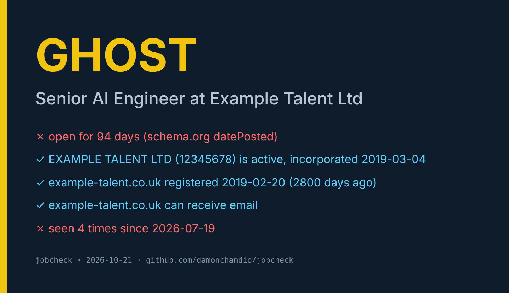

# jobcheck

**Paste a job URL. In seconds, with no account, it tells you whether the employer legally exists, how long the ad has really been open, and whether you are about to apply to a ghost.**

Facts, not a vibe score. Every other ghost-job tool reads the wording and guesses. jobcheck checks the things that can be checked: the company register, the posting date the board embeds, the age of the employer's domain, and whether you have seen this exact ad before.



```bash
npx skills add damonchandio/jobcheck -g
```

Works in Claude Code, Codex, Cursor, Gemini CLI, OpenCode, Copilot and any agent that reads SKILL.md. Or run it yourself:

```bash
python3 scripts/jobcheck.py https://example.com/jobs/123
```

```
GHOST (high confidence): Senior AI Engineer at Example Talent Ltd
  ✗ open for 94 days (schema.org datePosted)
  ✓ EXAMPLE TALENT LTD (12345678) is active, incorporated 2019-03-04
  ✓ example-talent.co.uk registered 2019-02-20 (2800 days ago)
  ✓ example-talent.co.uk can receive email
  ✗ seen 4 times since 2026-07-19
  → https://find-and-update.company-information.service.gov.uk/company/12345678
```

## What it checks

| Signal | Source | Counts against the ad when |
|---|---|---|
| Posting age | schema.org `datePosted` / `validThrough`, or "posted N days ago" | 60+ days, or past its closing date |
| Employer | Companies House search and profile | not found, dissolved, in liquidation, or accounts / confirmation statement overdue |
| Domain age | RDAP registration date | under 180 days |
| Mail | MX record via DNS over HTTPS | the domain cannot receive email |
| Contact | reply addresses in the ad | on Gmail, Outlook, Yahoo and similar |
| Wording | fee, bank details before starting, chat-app-only contact, crypto pay, "always hiring", talent-pool language | weighted; 3+ points is a scam |
| Repost | local SQLite ledger keyed on employer + description | the same ad seen 3+ times |

Verdicts: **REAL**, **GHOST**, **SCAM**, **SUSPECT**, **UNVERIFIED**. `--json` gives a fixed schema (`verdict`, `confidence`, `signals[]`, `evidence[]`) so an application agent can gate on it. `--card out.html` writes a verdict card you can share.

## Companies House key (optional, free)

The registry step needs a key. Get one in two minutes at [developer.company-information.service.gov.uk](https://developer.company-information.service.gov.uk), then:

```bash
export COMPANIES_HOUSE_API_KEY=your-key
```

Without it, jobcheck still reports posting age, domain, contact, wording and reposts, and marks the employer check as skipped.

## When the page needs a login

LinkedIn and Indeed block anonymous fetches. Paste the text instead:

```bash
python3 scripts/jobcheck.py - --employer "Employer Ltd" < job.txt
```

Inside an agent that already has the page open, that is what the skill does automatically.

## How it compares

| | Checks the company register | Posting age from board data | Repost ledger | Runs locally, no account | Agent skill |
|---|---|---|---|---|---|
| jobcheck | yes (Companies House) | yes | yes | yes | yes |
| ghostjobs.net | no | crowd reports | no | hosted | no |
| Text-scoring extensions and scripts | no | sometimes | no | mostly | no |
| ai-job-search / career-ops | no | no | no | yes | yes (no verification step) |

## Limits

- UK employers only for the registry check. Charities, universities, the NHS, sole traders and non-UK companies are "not found", not fake.
- Agencies advertise under their own name. A "not found" on the agency's trading name is common; pass `--employer` with the legal name if you know it.
- Posting age needs a date on the page. Some boards show none.
- The repost ledger only knows what this machine has checked.
- A REAL verdict means the facts line up. It is not a promise the role will be filled, and it is not legal advice.

## Tests

```bash
python3 -m unittest discover -s tests -v
```

18 tests, no network.

## Why

I'm an AI engineer in West Yorkshire who was job hunting with an agent doing the legwork. It kept finding roles that had been open for months, or employers I couldn't find on Companies House. The agent needed a check it could run before applying. This is that check.

MIT. If it saves you an application, a ⭐ helps other people find it.
